

<picture><source media="(prefers-color-scheme: dark)" srcset="assets/expressive-v2/hero-dark.svg"></picture>

<a href="https://t.me/xbibzofc"><picture><source media="(prefers-color-scheme: dark)" srcset="assets/expressive-v2/social-1-dark.svg"></picture></a>&nbsp;&nbsp;<a href="https://xbibzofficial.my.id"><picture><source media="(prefers-color-scheme: dark)" srcset="assets/expressive-v2/social-2-dark.svg"></picture></a>&nbsp;&nbsp;<a href="mailto:xbibzofficial@protonmail.com"><picture><source media="(prefers-color-scheme: dark)" srcset="assets/expressive-v2/social-3-dark.svg"></picture></a>

<picture><source media="(prefers-color-scheme: dark)" srcset="assets/expressive-v2/about-dark.svg"></picture>

<picture><source media="(prefers-color-scheme: dark)" srcset="assets/expressive-v2/stack-dark.svg"></picture>

<a href="https://github.com/XbibzOfficial777/Mochy-Music"><picture><source media="(prefers-color-scheme: dark)" srcset="assets/expressive-v2/project-mochy-music-dark.svg"></picture></a>&nbsp;<a href="https://github.com/XbibzOfficial777/evillimiter"><picture><source media="(prefers-color-scheme: dark)" srcset="assets/expressive-v2/project-evillimiter-dark.svg"></picture></a>

<a href="https://github.com/XbibzOfficial777/whatsbibz"><picture><source media="(prefers-color-scheme: dark)" srcset="assets/expressive-v2/project-whatsbibz-dark.svg"></picture></a>&nbsp;<a href="https://github.com/XbibzOfficial777/telebibz"><picture><source media="(prefers-color-scheme: dark)" srcset="assets/expressive-v2/project-telebibz-dark.svg"></picture></a>

<a href="https://github.com/XbibzOfficial777/plinteng-ai"><picture><source media="(prefers-color-scheme: dark)" srcset="assets/expressive-v2/project-plinteng-ai-dark.svg"></picture></a>&nbsp;<a href="https://github.com/XbibzOfficial777/Bibz-Islamic-App"><picture><source media="(prefers-color-scheme: dark)" srcset="assets/expressive-v2/project-bibz-islamic-app-dark.svg"></picture></a>

&nbsp;<a href="https://github.com/XbibzOfficial777/evillimiter">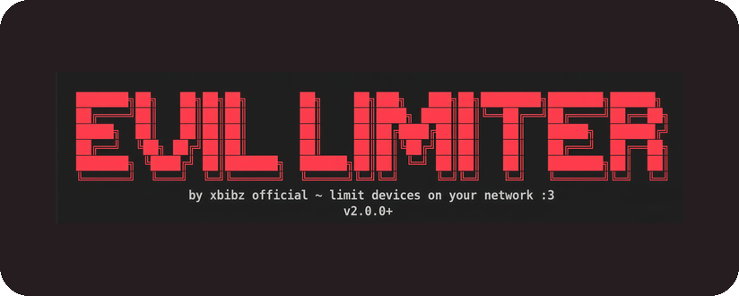</a>

<picture><source media="(prefers-color-scheme: dark)" srcset="assets/expressive-v2/stats-dark.svg"></picture>

<picture><source media="(prefers-color-scheme: dark)" srcset="assets/expressive-v2/streak-dark.svg"></picture>

<picture><source media="(prefers-color-scheme: dark)" srcset="assets/expressive-v2/wave-dark.svg"></picture>

<a href="https://xbibzofficial.my.id"><picture><source media="(prefers-color-scheme: dark)" srcset="assets/expressive-v2/button-1-dark.svg"></picture></a>&nbsp;&nbsp;<a href="https://jasjus.xbibzclone.my.id"><picture><source media="(prefers-color-scheme: dark)" srcset="assets/expressive-v2/button-2-dark.svg"></picture></a>&nbsp;&nbsp;<a href="https://github.com/XbibzOfficial777?tab=repositories"><picture><source media="(prefers-color-scheme: dark)" srcset="assets/expressive-v2/button-3-dark.svg"></picture></a>

