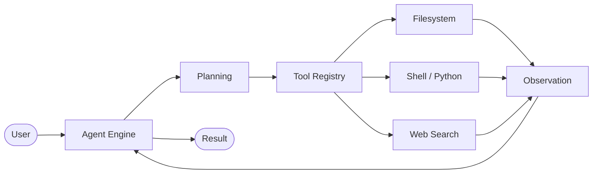

<!--
  XbibzOfficial777 | GitHub Profile
  Design: Midnight Liquid Glass
  Keep this file in the root of the repository named "XbibzOfficial777".
-->

<div align="center">

  

  <p>
    <a href="https://xbibzofficial.my.id"></a>
    <a href="https://github.com/XbibzOfficial777"></a>
    <a href="https://tiktok.com/@xbibzofficial"></a>
    <a href="https://t.me/xbibzofc"></a>
    <a href="mailto:xbibzofficial@protonmail.com"></a>
  </p>

  

</div>

---

## About

I'm a developer interested in building modern web applications, practical developer tools, and open-source projects. I enjoy exploring new technologies, turning ideas into useful products, and improving the way software is built.

- Focused on modern web development and open-source command-line tools.
- Exploring artificial intelligence, machine learning, and scalable backend architecture.
- Interested in Python, JavaScript, Node.js, and developer tooling.
- Open to meaningful collaboration on open-source projects.
- Most productive during late-night building sessions.

<div align="center">
  
</div>

---

## Featured project

<div align="center">
  <a href="https://github.com/XbibzOfficial777/BibzCode">
    
  </a>
</div>

### [BibzCode CLI Agent](https://github.com/XbibzOfficial777/BibzCode)

An autonomous AI-powered command-line agent built to assist with development workflows. BibzCode is designed to interpret requests, plan multi-step tasks, and use integrated tools to carry out work directly from the terminal.

| Capability | Details |
|:--|:--|
| **Agentic reasoning** | Breaks complex requests into structured, multi-step plans. |
| **Integrated tools** | Filesystem, shell, web search, Python execution, and Git operations. |
| **Multi-provider AI** | OpenRouter, Gemini, Anthropic, Groq, Together AI, Hugging Face, and OpenAI. |
| **Terminal experience** | Real-time streaming, progress tracking, and syntax highlighting. |
| **Mobile-ready** | Designed to run in Android Termux and other terminal environments. |
| **Execution controls** | Built-in command validation and configurable autonomous operation. |

#### Agent workflow



<details>
  <summary><strong>Quick installation</strong></summary>

  ```bash
  curl -fsSL https://bibzcode.bibzflow.workers.dev/install.sh | bash
  ```

</details>

<p>
  
  
  
  
</p>

---

## More projects

<div align="center">
  <a href="https://github.com/XbibzOfficial777/ytmusicscraper">
    
  </a>
</div>

---

## Tech stack

Tools and technologies I work with or explore.

### Languages

<p>
  
</p>

### Frameworks & libraries

<p>
  
</p>

### Database & backend

<p>
  
</p>

### Tools & platforms

<p>
  
</p>

### Design

<p>
  
  
</p>

---

## GitHub analytics

<div align="center">
  
  
</div>

<div align="center">
  
</div>

<div align="center">
  
</div>

<details>
  <summary><strong>GitHub trophies</strong></summary>
  <div align="center">
    
  </div>
</details>

---

## Let's connect

Have an idea, a project to discuss, or an opportunity to collaborate? Feel free to reach out.

<div align="center">

  <a href="https://xbibzofficial.my.id"></a>
  <a href="https://github.com/XbibzOfficial777"></a>
  <a href="https://tiktok.com/@xbibzofficial"></a>
  <a href="https://t.me/xbibzofc"></a>

  <br><br>

  **Support & business inquiries**

  <a href="mailto:xbibzofficial@protonmail.com">xbibzofficial@protonmail.com</a>

  <br><br>

  

  <sub>Built with care by <a href="https://github.com/XbibzOfficial777"><strong>XbibzOfficial777</strong></a>.</sub>

</div>
